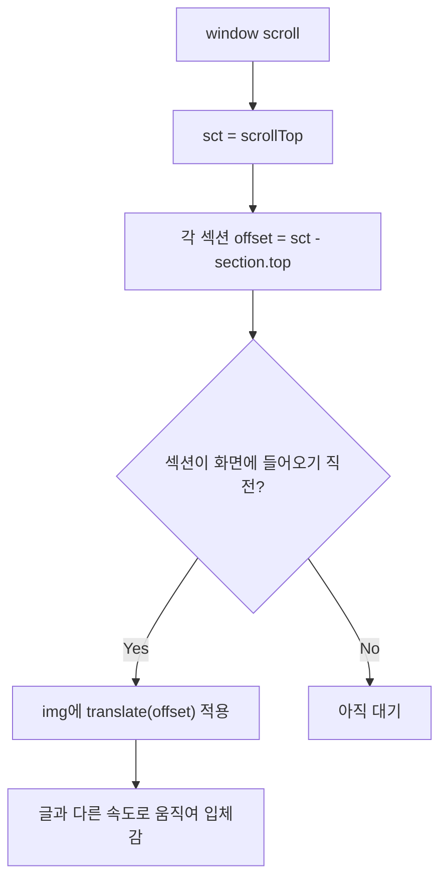

# 패럴랙스 스크롤 예제 설명 · 수정

원본 코드의 **동작 원리**, **틀린 부분**, **수정본**을 정리합니다.  
수정 파일: `javascript/parallax-block-reveal.html`

---

## 1. 이 예제가 하려는 일

스크롤할 때 **섹션마다 이미지가 글자와 다른 속도로 움직이게** 해서 입체감(패럴랙스)을 만듭니다.

```
스크롤 ↓
─────────────────────────────────────
  텍스트(고정에 가깝게)     이미지(translate로 미끄러짐)
  ┌──────────┐              ┌──────────┐
  │ funky... │              │  [사진]  │ ← offset만큼 이동
  └──────────┘              └──────────┘
─────────────────────────────────────
```

핵심 공식:

```text
offset = 현재스크롤(sct) - 섹션의 top 위치

스크롤이 섹션에 가까워질수록 offset이 -큰값 → 0 → +값으로 변함
이 값을 transform: translate(...) 에 넣어 이미지가 따라 움직임
```

---

## 2. 스크롤·offset 도식

```text
페이지 위쪽
    │
    │  sct (window.scrollTop)
    ▼
───────────── 뷰포트(화면) ─────────────
│                                     │
│         보이는 영역                  │
│                                     │
───────────── 뷰포트 끝 ───────────────
    │
    │  아직 안 보인 섹션 .s2
    │  offset2 = sct - $(".s2").offset().top   ← 보통 음수
    ▼
┌─────────────────────────────────────┐
│  .s2  텍스트 | 이미지                 │  ← 섹션 top
└─────────────────────────────────────┘
```

**언제 움직이기 시작하나?**

```javascript
if (sct >= $(".s2").offset().top - $(window).height())
```

의미:

```text
섹션 top이 "화면 맨 아래"에 닿는 순간부터 transform 적용

        화면
   ┌─────────┐
   │         │
   │         │  ← window height
   └─────────┘  ← 여기까지 오면
   ░░░░░░░░░░░  .s2 가 보이기 직전/직후부터 패럴랙스 시작
   [  .s2   ]
```

---

## 3. 섹션별 의도 (수정 후)

| 섹션 | 이미지 움직임 | transform |
|------|---------------|-----------|
| s1 | 히어로 텍스트만 (패럴랙스 없음) | - |
| s2 | **가로** (왼쪽↔오른쪽) | `translate(offset, 0)` |
| s3 | **가로** | `translate(offset, 0)` |
| s4 | **세로** (위↔아래) | `translate(0, offset)` |
| s5 | **세로 × 2** (더 빠르게) | `translate(0, offset*2)` |
| s6 | **가로** | `translate(offset, 0)` |

s2·s4·s6은 **글 왼쪽 / 그림 오른쪽**, s3·s5는 **그림 왼쪽 / 글 오른쪽** 레이아웃입니다.

---

## 4. 틀린·부족한 부분

### (1) s4에 transform이 두 번 → 뒤가 앞을 덮음 (버그)

```javascript
// ① 가로
$('.s4 .sec_img').css({'transform':'translate('+offset4+'px, 0px)'});

// ② 세로  ← 같은 조건에서 나중에 실행되어 ①이 무의미
$('.s4 .sec_img').css({'transform':'translate(0px, '+offset4+'px)'});
```

**결과:** s4는 항상 세로만 적용됨.  
**수정:** s4는 세로만 남기고, 가로 블록 삭제.

### (2) 구글 폰트 URL 따옴표 오타

```html
<!-- 잘못됨: 끝에 작은따옴표가 하나 더 있음 -->
...family=Lato:...,900,900i'" >

<!-- 수정 -->
...family=Lato:100,100i,300,300i,400,400i,700,700i,900,900i">
```

### (3) `#nav.on` 은 있는데, 클래스를 넣는 JS가 없음

CSS만 있고 스크롤 시 `on`을 토글하지 않아 **헤더 숨김이 동작하지 않음**.  
수정본에서는 아래로 스크롤할 때 헤더를 숨기도록 추가했습니다.

### (4) `scrolled1`, `scrolled2`, `scrolled3` 미사용

HTML에는 클래스가 있으나 JS가 이미지를만 움직임.  
제목의 “Block Reveal”과 맞추려면 텍스트에도 약한 패럴랙스를 주는 편이 좋음 → 수정본에 반영.

### (5) 기타

| 항목 | 내용 |
|------|------|
| jQuery UI | 로드만 하고 미사용 → 제거 |
| `console.log` | 디버그용 → 제거 |
| `img/1.jpg` ~ | 폴더 없으면 깨짐 → 수정본은 placeholder 이미지 사용 |
| viewport `user-scalable=no` | 접근성상 비권장 → 일반 viewport로 변경 |

---

## 5. 패럴랙스 흐름 (한 장 요약)



---

## 6. 수정 핵심 코드

```javascript
$(window).on('scroll', function () {
  var sct = $(window).scrollTop();
  var wh = $(window).height();

  function move($sec, $img, axis, speed) {
    var top = $sec.offset().top;
    if (sct < top - wh) return;
    var offset = (sct - top) * speed;
    if (axis === 'x') {
      $img.css('transform', 'translate(' + offset + 'px, 0)');
    } else {
      $img.css('transform', 'translate(0, ' + offset + 'px)');
    }
  }

  move($('.s2'), $('.s2 .sec_img'), 'x', 1);
  move($('.s3'), $('.s3 .sec_img'), 'x', 1);
  move($('.s4'), $('.s4 .sec_img'), 'y', 1);   // 세로만 (중복 제거)
  move($('.s5'), $('.s5 .sec_img'), 'y', 2);   // 2배 빠르게
  move($('.s6'), $('.s6 .sec_img'), 'x', 1);
});
```

---

## 7. 실행 방법

1. `javascript/parallax-block-reveal.html` 을 Live Server로 열기  
2. 스크롤하며 s2~s6 이미지가 가로/세로로 미끄러지는지 확인  
3. 위로 스크롤하면 헤더가 다시 나타남  

수업 포인트: **“같은 스크롤량인데 transform 계수만 바꾸면 속도가 달라진다”** = 패럴랙스의 본질.
