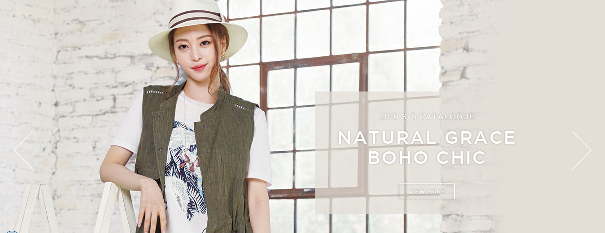

# 지센(ZISHEN) 사이트 구조 설명

PC 메뉴 · 모바일 메뉴 · Hero · BEST · NEW · Footer · 반응형 본문을  
`지센/index.html` · `css/style.css` · `js/main.js` 기준으로 정리한 수업용 문서입니다.

**참고 파일**

| 파일 | 역할 |
|------|------|
| [index.html](./index.html) | 전체 HTML 구조 |
| [css/style.css](./css/style.css) | PC·반응형 스타일 |
| [js/main.js](./js/main.js) | PC 서브메뉴 hover, 모바일 햄버거·아코디언 |

---

## 1. 전체 레이아웃 한눈에

```
┌─────────────────────────────────────────────┐
│  .header                                    │
│  [SNS] [마일리지]    [로고]    [Login Join] │
├─────────────────────────────────────────────┤
│  .nav  (PC 전용 GNB + 서브메뉴)              │
│  또는 .mobile_tab + .mobile_nav (모바일)     │
├─────────────────────────────────────────────┤
│  .hero   ← 메인 비주얼                       │
├─────────────────────────────────────────────┤
│  .best-items   BEST ITEMS (상품 3열)         │
├─────────────────────────────────────────────┤
│  .new-items    NEW ARRIVAL (상품 3열)        │
├─────────────────────────────────────────────┤
│  .footer       회사정보 · 링크 · 연락처       │
└─────────────────────────────────────────────┘
.transparency  ← 모바일 메뉴 열릴 때 반투명 막
```

```html
<div class="container">
  <div class="header">...</div>
  <div class="mobile_tab">...</div>   <!-- 모바일 햄버거 -->
  <div class="mobile_nav">...</div>   <!-- 모바일 사이드 메뉴 -->
  <div class="nav">...</div>          <!-- PC GNB -->
  <div class="hero">...</div>
  <section class="best-items">...</section>
  <section class="new-items">...</section>
  <footer class="footer">...</footer>
</div>
<div class="transparency"></div>
```

---

## 2. Header (상단)

### 구성

| 영역 | 클래스 | 역할 |
|------|--------|------|
| SNS · 마일리지 | `.social` | 소셜 아이콘 + 마일리지 버튼 |
| 로고 | `.signature` | 브랜드 로고 (가운데) |
| 유틸 메뉴 | `.location` | Login / Join / 개인정보취급방침 |

### PC 배치

```
float: left          float: left(+margin)       float: right
┌──────────┐         ┌────────┐                ┌──────────────┐
│  social  │         │  logo  │                │  location    │
└──────────┘         └────────┘                └──────────────┘
```

- `.header` 기본 너비: **1019px** (가운데 정렬)
- 로고는 `margin-left`로 시각적 중앙에 가깝게 배치

### 반응형에서 Header가 바뀌는 지점

| 너비 | 변화 |
|------|------|
| ≤1050px | header 너비 축소, GNB 마지막 메뉴(COMPANY) 숨김 |
| ≤850px | location 숨김, 마일리지 숨김, **햄버거 버튼 표시**, PC `.nav` 숨김 |
| ≤350px | SNS까지 숨김, 로고만 왼쪽 고정 |

---

## 3. PC용 메뉴 (`.nav`) ⭐

### HTML 구조

```html
<div class="nav">
  <ul>
    <li>
      <a href="">ZISHEN</a>          <!-- 1depth -->
      <ul class="sub">               <!-- 2depth -->
        <li><a href="">About</a></li>
        <li><a href="">Lookbook</a></li>
        <li><a href="">Catalogue</a></li>
      </ul>
    </li>
    <!-- ZISHEN HOMME / MEDIA / SERVICE / SHOP INFO / COMPANY -->
  </ul>
</div>
```

### PC 메뉴 동작 원리

1. 기본: `ul` 높이 **54px**, `overflow: hidden` → **서브메뉴가 잘려서 안 보임**
2. 마우스 올리면 JS가 `.over` 클래스 추가 → 높이 **185px**로 늘어남 → 서브 노출
3. 마우스가 벗어나면 `.over` 제거 → 다시 54px

```css
.nav > ul {
  height: 54px;
  overflow: hidden;
  transition: height 0.3s;
}
.nav > ul.over {
  height: 185px;   /* 서브 메뉴 영역까지 펼침 */
}
```

```javascript
// js/main.js
$(".nav ul").hover(function () {
  $(this).addClass("over");
}, function () {
  $(this).removeClass("over");
});
```

### 도식

```
[닫힘]  height:54px
┌────────────────────────────────┐
│ ZISHEN  HOMME  MEDIA  SERVICE… │  ← 1depth만 보임
└────────────────────────────────┘

[열림]  .over → height:185px
┌────────────────────────────────┐
│ ZISHEN  HOMME  MEDIA  SERVICE… │
│ About   About  Movie  Faq …    │  ← .sub
│ Lookbook …                     │
│ Catalogue …                    │
└────────────────────────────────┘
```

### 수업 포인트

- PC는 **가로 GNB + hover로 전체 패널 높이 확장**
- 서브는 각 `li` 아래 `position: absolute`로 배치
- hover 시 글자색 `#b4252d` (브랜드 포인트 컬러)

---

## 4. 반응형(모바일) 메뉴 ⭐

### 구성 요소

| 요소 | 역할 |
|------|------|
| `.mobile_tab` | 햄버거(☰) 버튼 — PC에서는 `display:none` |
| `.mobile_nav` | 오른쪽에서 슬라이드되는 사이드 메뉴 |
| `.transparency` | 메뉴 열릴 때 화면 어둡게 (클릭 시 닫기) |

### 850px 이하에서 전환

```css
@media screen and (max-width: 850px) {
  .mobile_tab { display: block; }  /* 햄버거 보임 */
  .nav { display: none; }          /* PC 메뉴 숨김 */
}
```

### 모바일 메뉴 열기/닫기

```
기본:  .mobile_nav { right: -220px; }   ← 화면 밖
열림:  .mobile_nav.active { right: 0; } ← 오른쪽에서 들어옴
```

```javascript
$('.mobile_tab').click(function () {
  $('.mobile_nav').addClass('active');
  $('.transparency').addClass('active');
  $('.container').addClass('active');
});

$('.transparency').click(function () {
  $('.mobile_nav').removeClass('active');
  $('.transparency').removeClass('active');
  // ...
});
```

### 모바일 서브 = 아코디언

1depth 클릭 시 해당 `.sub`만 `slideDown`, 나머지는 `slideUp`

```javascript
$(".mobile_nav > ul > li > a").click(function () {
  // 닫혀 있으면 열고, 열려 있으면 닫기
  $(this).next(".sub").slideDown(300); // 또는 slideUp
  return false;
});
```

### 도식

```
PC (>850px)                    Mobile (≤850px)
┌──────────────────┐           ┌────────────┬──────┐
│     .nav (GNB)   │           │  로고  [☰] │      │
└──────────────────┘           └────────────┤ side │
                                            │ menu │
                                            │.mobile│
                                            │ _nav │
                                            └──────┘
```

### 리사이즈 시 정리

창을 다시 넓히면(>850) 모바일 메뉴가 열린 채로 남지 않도록 `active` 제거:

```javascript
$(window).resize(function () {
  if ($(this).width() > 850) {
    $('.mobile_nav').removeClass('active');
    $('.transparency').removeClass('active');
  }
});
```

---

## 5. Hero (메인 비주얼)

```html
<div class="hero"></div>
```

| 속성 | 의미 |
|------|------|
| `margin-top: 54px` | PC GNB 높이만큼 본문 시작점 확보 |
| `img { width:100% }` | 가로에 맞춰 반응형 이미지 |
| 모바일(≤850) | `margin-top: 0` (GNB가 사라지므로) |

---

## 6. BEST ITEMS (`.best-items`)

### 역할

쇼핑몰 메인에서 **인기 상품**을 보여주는 섹션입니다.

### HTML 골격

```html
<section class="best-items">
  <div class="section-container">
    <h2 class="section-title">BEST ITEMS</h2>
    <div class="items-grid">
      <div class="item">
        <div class="item-image">
          
          <div class="item-overlay">
            <button class="btn-view">VIEW DETAILS</button>
          </div>
        </div>
        <div class="item-info">
          <h3 class="item-name">Premium Jacket</h3>
          <p class="item-price">₩189,000</p>
        </div>
      </div>
      <!-- 상품 카드 반복 -->
    </div>
  </div>
</section>
```

### 카드(`.item`) 구성

```
┌─────────────────┐
│   상품 이미지    │  .item-image
│  (hover 시      │  → overlay + VIEW DETAILS
│   확대·버튼)     │
├─────────────────┤
│  상품명          │  .item-name
│  가격            │  .item-price
└─────────────────┘
```

### PC 그리드

```css
.items-grid {
  display: grid;
  grid-template-columns: repeat(3, 1fr);  /* 3열 */
  gap: 30px;
}
```

### Hover 효과

| 효과 | CSS |
|------|-----|
| 카드 위로 | `.item:hover { transform: translateY(-10px); }` |
| 이미지 확대 | `.item:hover img { transform: scale(1.1); }` |
| 어두운 막 + 버튼 | `.item-overlay` opacity 0 → 1 |

### JS

`.btn-view` 클릭 시 상품명 alert (데모). 실무에서는 상세 페이지/모달로 연결.

---

## 7. NEW ARRIVAL (`.new-items`)

### 역할

**신상품** 영역. BEST와 거의 같은 카드 구조 + `NEW` 뱃지.

```html
<span class="badge-new">NEW</span>
```

| BEST | NEW |
|------|-----|
| `.best-items` | `.new-items` |
| 배경 `#fff` | 배경 `#f8f8f8` (섹션 구분) |
| 뱃지 없음 | `.badge-new` (우측 상단) |

구조·그리드·hover는 BEST와 **동일한 패턴** → 수업에서 “섹션 복제 후 제목·뱃지만 변경”으로 설명하기 좋습니다.

---

## 8. Footer (`.footer`)

### 역할

사이트 하단 **회사 소개 · 고객센터 · 약관 · 연락처 · 저작권**.

### HTML 골격

```html
<footer class="footer">
  <div class="footer-container">
    <div class="footer-content">
      <div class="footer-section footer-about">...</div>   <!-- 브랜드 -->
      <div class="footer-section footer-links">...</div>   <!-- CS -->
      <div class="footer-section footer-info">...</div>    <!-- 회사/약관 -->
      <div class="footer-section footer-contact">...</div> <!-- 연락처 -->
    </div>
    <div class="footer-bottom">
      <p>&copy; 2025 ZISHEN. All rights reserved.</p>
    </div>
  </div>
</footer>
```

### PC 배치 (Grid)

```css
.footer-content {
  display: grid;
  grid-template-columns: 2fr 1fr 1fr 1.5fr;  /* 약 / CS / INFO / CONTACT */
  gap: 40px;
}
```

```
┌──────────┬─────┬─────┬────────┐
│ ABOUT    │ CS  │INFO │CONTACT │
│ (넓게)   │     │     │        │
└──────────┴─────┴─────┴────────┘
│           © copyright          │
```

### 반응형 Footer

| 너비 | 열 구성 |
|------|---------|
| PC | 4열 (`2fr 1fr 1fr 1.5fr`) |
| ≤1024px | 2열 (ABOUT는 전체 폭 `grid-column: 1 / -1`) |
| ≤768px | **1열** (세로 스택) |

배경 `#2f2f2f`, 링크 hover 시 포인트 컬러 `#b4252d`.

---

## 9. 반응형 본문 (BEST / NEW / Footer) 정리

### 브레이크포인트 요약

| max-width | 메뉴 | 상품 그리드 | Footer |
|-----------|------|-------------|--------|
| **1050px** | GNB 메뉴 1개 축소 | — | — |
| **1200px** | — | gap 축소 | gap 축소 |
| **1024px** | — | **2열** | **2열** |
| **850px** | **PC nav → 모바일 햄버거** | — | — |
| **768px** | — | **1열** | **1열** |
| **480px** | — | 패딩·글자 축소 | 패딩·글자 축소 |
| **350px** | SNS 숨김 | — | — |

### 상품 그리드 변화 도식

```
PC (>1024)     태블릿 (≤1024)      모바일 (≤768)
┌──┐┌──┐┌──┐   ┌──┐┌──┐           ┌──────┐
│1 ││2 ││3 │   │1 ││2 │           │  1   │
└──┘└──┘└──┘   └──┘└──┘           ├──────┤
               ┌──┐┌──┐           │  2   │
               │3 ││… │           ├──────┤
               └──┘└──┘           │  3   │
                                  └──────┘
```

핵심 CSS:

```css
/* PC */
.items-grid { grid-template-columns: repeat(3, 1fr); }

@media (max-width: 1024px) {
  .items-grid { grid-template-columns: repeat(2, 1fr); }
}
@media (max-width: 768px) {
  .items-grid { grid-template-columns: 1fr; }
}
```

### 이미지 반응형

```css
img { max-width: 100%; }
.item-image { padding-top: 133.33%; } /* 3:4 비율 유지 */
.item-image img {
  position: absolute;
  width: 100%; height: 100%;
  object-fit: cover;
}
```

→ 카드 너비가 줄어들어도 **비율이 깨지지 않음**.

---

## 10. JS 역할 요약 (`main.js`)

| 기능 | 대상 | 설명 |
|------|------|------|
| PC 서브 펼침 | `.nav ul` | hover → `.over` |
| 모바일 열기 | `.mobile_tab` | `.active` 추가 |
| 모바일 닫기 | `.transparency` | `.active` 제거 |
| 모바일 아코디언 | `.mobile_nav a` | `slideDown` / `slideUp` |
| 리사이즈 정리 | `window` | 850px 초과 시 모바일 메뉴 초기화 |
| VIEW DETAILS | `.btn-view` | 데모 alert |
| 스크롤 페이드인 | `.item` | 화면에 들어오면 opacity 1 |

---

## 11. 수업용 체크리스트

### PC

- [ ] Header 3영역(SNS / 로고 / Login) 배치를 설명할 수 있다  
- [ ] `.nav` + `.over`로 서브메뉴가 열리는 원리를 안다  
- [ ] BEST / NEW가 Grid 3열인지 안다  
- [ ] Footer가 Grid 4열인지 안다  

### 반응형

- [ ] **850px**에서 PC 메뉴 ↔ 모바일 햄버거 전환  
- [ ] 모바일 사이드 메뉴 + 반투명 배경 닫기  
- [ ] 상품: 3열 → 2열(1024) → 1열(768)  
- [ ] Footer: 4열 → 2열 → 1열  

### 코드

- [ ] `viewport` 메타 태그 있음  
- [ ] `@media (max-width: …)` 로 분기  
- [ ] jQuery로 클래스 `active` / `over` 토글  

---

## 12. 관련 자료 (레이아웃 변형)

같은 지센을 **Float / Flex / Grid**로 다시 짠 예제도 있습니다.

| 방식 | 경로 |
|------|------|
| Float | [zishen/float/](./zishen/float/) · [CSS-Float-반응형-완전정복.md](./zishen/float/CSS-Float-반응형-완전정복.md) |
| Flex | [zishen/flex/](./zishen/flex/) · [CSS-Flexbox-반응형-완전정복.md](./zishen/flex/CSS-Flexbox-반응형-완전정복.md) |
| Grid | [zishen/grid/](./zishen/grid/) · [CSS-Grid-반응형-완전정복.md](./zishen/grid/CSS-Grid-반응형-완전정복.md) |

루트 `지센/index.html`은 **실무형 통합본**(PC GNB + 모바일 메뉴 + BEST/NEW/Footer 반응형)입니다.

---

## 한 줄 정리

> **PC:** `.nav` hover로 서브 펼침 · BEST/NEW 3열 · Footer 4열  
> **Mobile(≤850):** `.nav` 숨기고 햄버거 + 사이드 `.mobile_nav`  
> **본문 반응형:** Grid 열 수만 줄여 상품·푸터가 세로로 쌓이게 함
